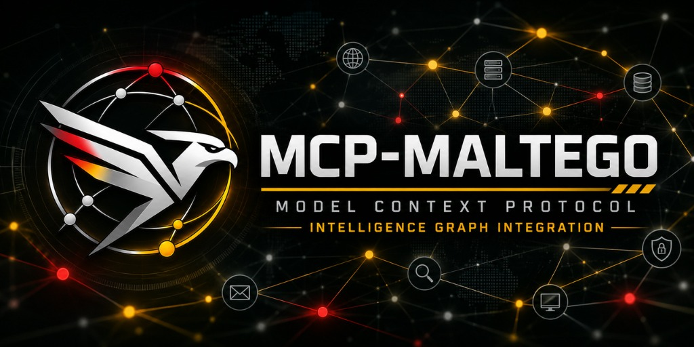

<h1 align="center">mcp-maltego</h1>

<p align="center">
  <strong>Maltego OSINT para agentes de IA.</strong><br>
  Ejecuta transforms y Machines, construye y analiza grafos de relaciones y devuelve el resultado a Maltego como
  <code>.mtgx</code> nativo, desde Claude, Gemini, Codex, Copilot, Cursor o cualquier cliente MCP.
</p>

<p align="center">
  
</p>

<p align="center">
  <a href="https://www.npmjs.com/package/mcp-maltego"></a>
  <a href="https://github.com/Data-Unix/MCP-MALTEGO/actions/workflows/ci.yml"></a>
  <a href="LICENSE"></a>
  
  
  
  <a href="https://registry.modelcontextprotocol.io/v0/servers?search=mcp-maltego"></a>
  
  <a href="CONTRIBUTING.md"></a>
  <a href="README.md"></a>
</p>

---

**mcp-maltego** es un servidor [Model Context Protocol](https://modelcontextprotocol.io) de alto rendimiento que convierte a cualquier agente de IA en un analista experto de Maltego. Ejecuta transforms reales, los encadena en Machines de reconocimiento autónomo, mantiene un grafo de investigación persistente con memoria de cada paso y procedencia explicable, recomienda el siguiente pivote y se sincroniza limpiamente con Maltego Desktop mediante archivos `.mtgx`.

> [!TIP]
> **Cero Coste y Sin Licencias Comerciales de Maltego**: No necesitas un plan de pago de Maltego (Pro/XL) ni claves comerciales para empezar. `mcp-maltego` funciona de forma completamente gratuita en local, generando archivos `.mtgx` nativos 100% compatibles con la versión gratuita **Maltego Community Edition (CE)** o Basic.

---

## 🏛️ Arquitectura Desacoplada en Tres Capas

`mcp-maltego` se estructura en tres capas modulares para que puedas comenzar de inmediato sin sobrecarga ni complejidad de configuración:

| Capa | Componente | Descripción y Coste |
| :--- | :--- | :--- |
| **Capa 0: Núcleo Gratuito** | CLI y Servidor MCP | Ejecución directa (`npx mcp-maltego`). Genera y lee archivos `.mtgx` para **Maltego Community Edition (CE)**. Incluye **33 transforms integrados sin API key** (DoH, RDAP/WHOIS, crt.sh, ASN Cymru, CISA KEV, URLhaus, AlienVault OTX, URLscan, Mempool.space Bitcoin UTXO, clustering CIOH, sanciones OFAC SDN y puntos VASP) y motor de plugins comunitarios (`@custom_transform`). **100% Local y Gratuito.** |
| **Capa 1: Memoria de Casos** | Memoria de Grafo y Copiloto | Almacenamiento local determinista de casos (`~/.maltego-mcp/graph.json`), fusión de identidades, auditoría forense de pasos, Machines autónomas y copiloto `osint_investigate`. |
| **Capa 2: Plataforma Avanzada** | Consola Web y Bóveda CTI | Web Dashboard interactivo (`maltegoctl dashboard`) con aceleración por Web Worker y 4 layouts (Orgánico, Jerárquico, Radial, Por Categoría), filtrado multidimensional (aristas, entidades, certeza continua, saltos y buscador en vivo), renderizado vectorial Impeccable (iconos en canvas, anillos de confianza y aristas Bézier), Suite Universal de Tablas (densidad compacta/normal/expandida, paginación, tarjetas acordeón detalladas), trazado de rutas multi-salto e inspección de radio de impacto, Ledger Blockchain AML con detección de mixers, aislamiento y scoping estricto de investigaciones independientes (Topbar global y selector modular en foco), purgado y eliminación definitiva de casos puntuales, Bóveda de Cuentas categorizadas (Redes, Foros Underground y Mercados Dark Web) con cookies y enrutamiento Tor SOCKS5, buzones efímeros (Mail.tm + extractor OTP), feeds CTI Tor/Dark Web y persistencia opcional en clúster Azure Cosmos DB Gremlin. |

---

## Características Principales

- **20 tools compatibles con todos los modelos.** Esquemas planos validados contra el subconjunto estricto de Gemini;
  las variantes van en un parámetro `action` para no saturar a los agentes.
- **45 transforms reales incluidos.** 33 sin API key (DNS sobre HTTPS, RDAP/WHOIS con respaldo ARIN, vulnerabilidades activas en CISA KEV, malware en Abuse.ch URLhaus, transparencia de certificados en crt.sh y CertSpotter, HackerTarget, urlscan.io, Shodan InternetDB, ASN y prefijos en Team Cymru y RIPE Stat, Gravatar, detalle en GitHub, pulsos de amenazas en AlienVault OTX, perfiles por alias, transacciones Bitcoin e inputs/outputs en Mempool.space, clustering por co-gasto CIOH, cotejo de sanciones cripto OFAC SDN, touchpoints en exchanges/VASPs y análisis) y 12 de proveedores que se activan al definir su clave: VirusTotal, Shodan, SecurityTrails, Censys, Hunter.io, Have I Been Pwned, GreyNoise y Tatum.
- **Motor de Extensibilidad Comunitaria (`@custom_transform`).** Permite soltar ficheros Python en `~/.maltego-mcp/plugins/` o `./plugins/` para exponer nueva lógica OSINT a los LLMs sin tocar el núcleo.
- **También tus transforms de Maltego.** Habla el protocolo XML TRX/iTDS de Maltego.
- **Machines.** DomainRecon, InfrastructureRecon, EmailRecon, CompanyFootprint, PersonalFootprint, PersonaFootprint, CryptoFlowRecon, URLRecon,
  ThreatSweep, ASNToNetblocks y las tuyas en TOML, con rondas recursivas y presupuestos.
- **Trazabilidad Criptoforense & AML Blockchain.** Ontología nativa (`maltego.CryptoCluster`, `maltego.VASPExchange`, `maltego.MixerContract`, `maltego.DeFiBridge`), reconstrucción de flujos transaccionales UTXO/EVM, heurísticas de co-gasto (CIOH) y peeling chains, detección de mezcladores (Tornado Cash, CoinJoin), verificación de sanciones OFAC SDN y puntos de salida a fiat (VASPs regulados con KYC).
- **Aislamiento Multi-Investigación y Scoping Modular de Proyectos.** Selector global de proyecto sincronizado en la cabecera (Topbar) y selector desacoplable independiente en cada módulo analítico ("Investigación en Foco" con modo predeterminado `[Seguir Activo]`), garantizando cero contaminación cruzada entre investigaciones forenses independientes.
- **Ciclo de Vida Forense y Purgado Definitivo de Casos.** Sistema de eliminación segura e irreversible de investigaciones puntuales con confirmación interactiva, purgado atómico de entidades y aristas en la base de datos de grafos, destrucción de caché local y de memoria de custodia/alertas, y conmutación automática de proyecto.
- **Copiloto de investigación.** `osint_investigate` lo hace todo en una llamada. Cada paso queda registrado (qué, sobre
  qué, por qué, resultado), cada entidad tiene procedencia y prioridad explicables, y la siguiente mejor acción aprende
  del rendimiento de cada transform.
- **Ida y vuelta con Maltego.** `.mtgx` con layout jerárquico, radial o por fuerzas y la memoria incluida; importación
  de `.mtgx`; transforms locales dentro de Maltego para abrir un caso, ver vecinos y enviar entidades a los agentes;
  importación de tu ontología exacta de Maltego.
- **Informes y CLI.** Informes en Markdown o HTML autocontenido y `maltegoctl` para terminal y CI.
- **Seguro por defecto.** Los datos OSINT se tratan como no confiables, XML con defusedxml, lecturas acotadas de
  ficheros comprimidos, sin URLs arbitrarias y sin API keys en los logs.

## Contribuciones y Gobernanza Comunitaria
¡Agradecemos las contribuciones! Todo cambio está sujeto a nuestra [Guía de Contribución](CONTRIBUTING.md). Las Pull Requests son evaluadas automáticamente por nuestro analizador AST de seguridad y blast radius, y toda fusión a `main` requiere la aprobación manual exclusiva del mantenedor principal [@Data-Unix](https://github.com/Data-Unix).

## Requisitos

- [Node.js](https://nodejs.org) 18 o superior (para `npx`).
- [uv](https://docs.astral.sh/uv/), que gestiona Python 3.12 (si no está instalado, `mcp-maltego` lo instala de forma
  autónoma en `~/.maltego-mcp/bin` en el primer arranque).

Prepara el entorno, la plantilla `~/.maltego-mcp/.env` y el `.mtz` para Maltego Desktop en un solo comando:

```bash
npx -y mcp-maltego setup
```

## Inicio rápido

Configuración estándar, válida para la mayoría de clientes MCP:

```json
{
  "mcpServers": {
    "maltego": {
      "command": "npx",
      "args": ["-y", "mcp-maltego"]
    }
  }
}
```

Y pide a tu agente:

> Investiga example.com, dame el resumen del caso y expórtalo para Maltego.

<details>
<summary><b>📦 Guía de Instalación y Primer Despliegue por Sistema Operativo</b></summary>

### 🍏 macOS (Apple Silicon M1/M2/M3/M4 & Mac Intel Core)

Compatible nativamente con arquitecturas `arm64` (Apple Silicon) y `x86_64` (Intel). No requiere Xcode ni compiladores C locales.

1. **Requisito inicial**: [Node.js](https://nodejs.org) 18 o superior (`brew install node` o instalador oficial).
2. **Auto-despliegue en 1 solo comando**:
   ```bash
   npx -y mcp-maltego setup
   ```
   *Este comando auto-detecta tu procesador (Intel o Apple Silicon), descarga uv nativo, crea el runtime aislado Python 3.12 en `~/.maltego-mcp`, genera `.env`, el paquete `.mtz` de Maltego y añade los comandos globales (`maltegoctl`, `mcp-maltego`) a tu shell `zsh` (`~/.zshrc` y `~/.zprofile`).*
3. **Lanzar el Centro de Mando / Dashboard interactivo**:
   ```bash
   maltegoctl dashboard
   ```
   *(Abre automáticamente `http://127.0.0.1:8000/dashboard` en Safari / Chrome con el visualizador gráfico de casos y la bóveda).*
4. **Verificar estado y diagnóstico**:
   ```bash
   maltegoctl doctor
   ```
5. **Integración con Maltego Desktop CE para Mac (`/Applications/Maltego.app`)**:
   - Genera el paquete de configuración local: `maltegoctl mtz`
   - En Maltego Desktop: Menú **Import \| Export → Import Config** y selecciona `~/.maltego-mcp/maltego-mcp-local.mtz`.

---

### 🪟 Windows (Windows 10 / 11 · PowerShell & Terminal)

1. **Requisito inicial**: [Node.js](https://nodejs.org) 18 o superior (`winget install OpenJS.NodeJS` o instalador oficial).
2. **Auto-despliegue en 1 solo comando**:
   ```powershell
   npx -y mcp-maltego setup
   ```
   *Instala `uv.exe` de forma autónoma en `%USERPROFILE%\.maltego-mcp\bin`, crea los ejecutables globales `.cmd` y `.ps1` en `%USERPROFILE%\.local\bin`, y actualiza el PATH de usuario de Windows y el perfil de PowerShell.*
3. **Lanzar el Dashboard interactivo**:
   ```powershell
   maltegoctl dashboard
   ```
   *(Abre `http://127.0.0.1:8000/dashboard` en tu navegador predeterminado).*

---

### 🐧 Linux (Ubuntu, Debian, Kali Linux, Arch, Fedora)

1. **Requisito inicial**: Node.js 18+ y `curl`.
2. **Auto-despliegue en 1 solo comando**:
   ```bash
   npx -y mcp-maltego setup
   ```
   *Configura el entorno en `~/.maltego-mcp`, los ejecutables en `~/.local/bin` y exporta la ruta a tu `~/.bashrc` o `~/.profile`.*
3. **Lanzar el Dashboard**:
   ```bash
   maltegoctl dashboard
   ```
</details>

<details>
<summary><b>🤖 Guía de Configuración con Agentes de IA en diferentes IDEs</b></summary>

### 🚀 Antigravity IDE
Para integrar el servidor MCP de Maltego con tus agentes en **Antigravity IDE**:

1. Abre la configuración de extensiones MCP o el archivo `.gemini/settings.json`:
   ```json
   {
     "mcpServers": {
       "maltego": {
         "command": "mcp-maltego"
       }
     }
   }
   ```
   *O de forma directa y portátil con npx:*
   ```json
   {
     "mcpServers": {
       "maltego": {
         "command": "npx",
         "args": ["-y", "mcp-maltego"]
       }
     }
   }
   ```
2. **Ejemplo de prompt operativo para el agente en Antigravity**:
   > *"Inicia un caso OSINT sobre `example.com`, ejecuta la Machine `DomainRecon` para mapear subdominios y servidores DNS, y guarda las entidades en el grafo para que pueda analizarlas en el visualizador web de `maltegoctl dashboard`."*

---

### 💻 Cursor IDE
En Cursor (**Settings → Features → MCP → Add New MCP Server**):
- **Name**: `maltego`
- **Type**: `command`
- **Command**: `npx -y mcp-maltego`

O en `~/.cursor/mcp.json` / `.cursor/mcp.json`:
```json
{
  "mcpServers": {
    "maltego": {
      "command": "npx",
      "args": ["-y", "mcp-maltego"]
    }
  }
}
```

---

### ⚡ Claude Code (CLI) y Claude Desktop
- **Claude Code**:
  ```bash
  claude mcp add maltego -- npx -y mcp-maltego
  ```
- **Claude Desktop**:
  En `claude_desktop_config.json` (**Settings → Developer → Edit Config**):
  ```json
  {
    "mcpServers": {
      "maltego": {
        "command": "npx",
        "args": ["-y", "mcp-maltego"]
      }
    }
  }
  ```

---

### 🧠 Codex CLI
```bash
codex mcp add maltego -- npx -y mcp-maltego
```
O en `~/.codex/config.toml`:
```toml
[mcp_servers.maltego]
command = "npx"
args = ["-y", "mcp-maltego"]
```

---

### ♊ Gemini CLI
En `~/.gemini/settings.json` o `.gemini/settings.json`:
```json
{
  "mcpServers": {
    "maltego": {
      "command": "npx",
      "args": ["-y", "mcp-maltego"]
    }
  }
}
```

---

### 🐙 VS Code / Copilot CLI
En `.vscode/mcp.json` o `.copilot/mcp-config.json`:
```json
{
  "servers": {
    "maltego": {
      "command": "npx",
      "args": ["-y", "mcp-maltego"]
    }
  }
}
```
</details>

| Cliente | Dónde va la configuración |
|---|---|
| Claude Code | `claude mcp add maltego -- npx -y mcp-maltego` |
| Claude Desktop | `claude_desktop_config.json` (Ajustes → Desarrollador → Editar configuración) |
| Gemini CLI | `~/.gemini/settings.json` o `.gemini/settings.json` |
| Codex | `codex mcp add maltego -- npx -y mcp-maltego` o `~/.codex/config.toml` |
| Copilot CLI | `~/.copilot/mcp-config.json`, `.mcp.json` o `.github/mcp.json` |
| VS Code | `.vscode/mcp.json` con clave `servers` |
| Cursor | `~/.cursor/mcp.json` o `.cursor/mcp.json` |
| OpenCode | `opencode.json` con `"type": "local"` y `command` como lista |
| Qwen Code | `~/.qwen/settings.json` o `.qwen/settings.json` |
| Orca IDE | Clona el repo: ya incluye el fichero de cada agente ([docs/ORCA.md](docs/ORCA.md)) |

Ejemplos exactos para cada cliente en el [README en inglés](README.md#getting-started).

## Tools

| Grupo | Tool | Para qué |
|---|---|---|
| Catálogo | `osint_list_entity_types` | Ontología por categoría (estándar + importada de tu Maltego) |
| | `osint_list_transforms` | Transforms, Machines, claves de proveedores y estado de servidores |
| Casos | `osint_manage_case` | Crear, fusionar o borrar (con confirmación) |
| | `osint_list_cases` | Listado paginado |
| | `osint_get_case_summary` | Recuentos, entidades prioritarias e índices de calidad |
| Entidades | `osint_upsert_entity` | Crear o fusionar (valor normalizado, id determinista, notas) |
| | `osint_manage_entity` | Editar confianza, notas o propiedades; borrar |
| | `osint_get_entity` | Detalle, puntuación explicada, procedencia, transforms pendientes |
| | `osint_search_entities` | Búsqueda en un caso o entre casos; orden por prioridad |
| Relaciones | `osint_link_entities` | Relacionar o desrelacionar |
| | `osint_get_neighbors` | Vecinos con dirección y tipo de relación |
| | `osint_find_paths` | Caminos entre dos entidades |
| Transforms | `osint_run_transform` | Un transform sobre una entidad |
| | `osint_expand_entity` | Todos los transforms aplicables ("Run All") |
| | `osint_run_machine` | Una Machine o una cadena propia, con rondas y presupuestos |
| Copiloto | `osint_investigate` | Todo en una llamada |
| | `osint_suggest_next_steps` | Siguiente mejor acción con historial de rendimiento |
| | `osint_get_timeline` | Memoria de la investigación; novedades con `since_seq` |
| Intercambio | `osint_export_case` | `mtgx`, `json`, `graphml`, `csv`, `report_md`, `report_html` |
| | `osint_import_graph` | Importar `.mtgx` de Maltego (con memoria) o CSV |

## API keys de proveedores

`VIRUSTOTAL_API_KEY`, `SHODAN_API_KEY`, `SECURITYTRAILS_API_KEY`, `CENSYS_API_ID` + `CENSYS_API_SECRET`,
`HUNTER_API_KEY`, `HIBP_API_KEY`, `GREYNOISE_API_KEY`, `TATUM_API_KEY`. Pásalas en el bloque `env` de la
configuración del cliente o como variables de entorno de usuario.

## Integración con Maltego Desktop

| Dirección | Cómo |
|---|---|
| Agente → Maltego | `osint_export_case` genera un `.mtgx`; ábrelo con **File → Open** |
| Maltego → agente | Guarda el `.mtgx` en `~/.maltego-mcp/imports/` y pide al agente que lo importe |
| En vivo dentro de Maltego | `npx mcp-maltego ctl mtz` genera los transforms locales **MCP · Abrir caso**, **MCP · Vecinos en el caso** y **MCP · Guardar en el caso**; impórtalo con **Import \| Export → Import Config** |
| Tu ontología | Exporta tu configuración de Maltego y ejecuta `npx mcp-maltego ctl import-entities config.mtz` |

Para el puente, instala el paquete de forma global (`npm i -g mcp-maltego`). Detalles en [docs/MALTEGO.md](docs/MALTEGO.md).

## Agentes y skills

El repositorio incluye 10 agentes y 15 skills con una única fuente (`.agents/`) para Claude Code, Gemini CLI, Qwen
Code, GitHub Copilot, Codex y Cursor: agentes de investigación (`osint-analyst`, `cti-analyst`, `ioc-composer`,
`recon-toolchain-integrator`) y de desarrollo, y skills de huella corporativa, identidad digital, infraestructura,
composición de IOC con otros MCP, herramientas OSINT externas, proveedores propios, entidades no estándar y
despliegue. Sin capacidades ofensivas (explotación).

## Documentación

- Uso y configuración: [docs/USO.md](docs/USO.md)
- Maltego Desktop: [docs/MALTEGO.md](docs/MALTEGO.md)
- Orca y varios agentes: [docs/ORCA.md](docs/ORCA.md)
- Cobertura funcional y verificación: [docs/COBERTURA.md](docs/COBERTURA.md)
- Seguridad: [SECURITY.md](SECURITY.md) · Cambios: [CHANGELOG.md](CHANGELOG.md) · Contribuir: [AGENTS.md](AGENTS.md)

## Uso responsable

Esta herramienta consulta fuentes públicas. Eres responsable de cumplir la ley, los términos de cada proveedor y la
normativa de protección de datos (por ejemplo, el RGPD).

## Licencia

[MIT](LICENSE). Maltego es una marca de Maltego Technologies GmbH. Este proyecto es independiente y no está afiliado
ni respaldado por Maltego Technologies.
