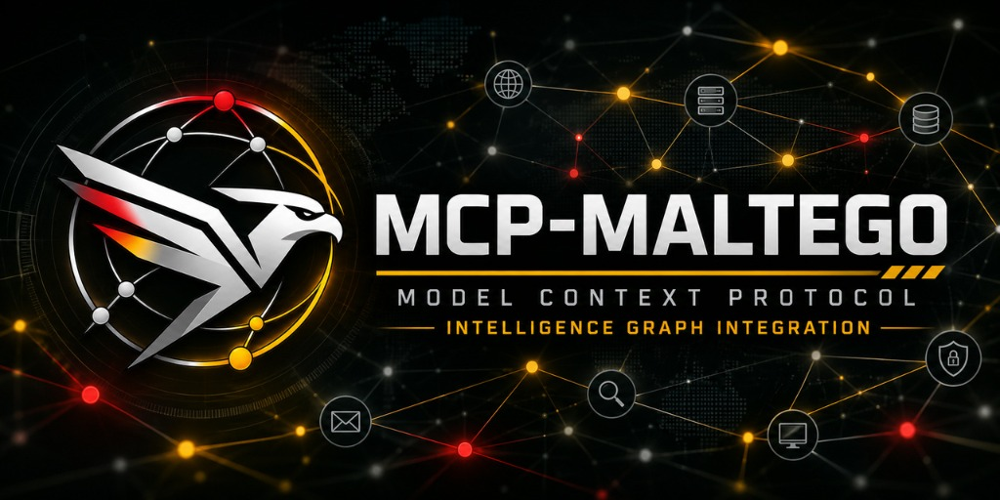

<h1 align="center">mcp-maltego</h1>

<p align="center">
  <strong>Maltego OSINT for AI agents.</strong><br>
  Run transforms and Machines, build and analyse link graphs, and hand the result back to Maltego as a native
  <code>.mtgx</code>, from Claude, Gemini, Codex, Copilot, Cursor or any MCP client.
</p>

<p align="center">
  
</p>

<p align="center">
  <a href="https://www.npmjs.com/package/mcp-maltego"></a>
  <a href="https://github.com/Data-Unix/MCP-MALTEGO/actions/workflows/ci.yml"></a>
  <a href="LICENSE"></a>
  
  
  
  
  <a href="CONTRIBUTING.md"></a>
  <a href="README.es.md"></a>
</p>

---

**mcp-maltego** is a high-performance [Model Context Protocol](https://modelcontextprotocol.io) server that turns any AI agent into an expert Maltego operator. It runs real OSINT transforms, chains them into autonomous reconnaissance Machines, maintains an in-memory or graph database investigation state with full provenance, recommends next-best pivots, and synchronizes seamlessly with Maltego Desktop via native `.mtgx` files.

> [!TIP]
> **Zero-Cost & No Commercial Maltego License Required**: You do **not** need a paid Maltego Pro/XL plan or commercial API keys to start. `mcp-maltego` runs completely free out of the box, generating native `.mtgx` graphs compatible with the free **Maltego Community Edition (CE)** or Basic tier.

---

## 🏛️ Layered Architecture: From Zero-Cost Core to Full Platform

`mcp-maltego` is built in three decoupled layers so you can start instantly without cloud infrastructure or configuration overhead:

| Layer | Component | Description & Cost |
| :--- | :--- | :--- |
| **Layer 0: Zero-Cost Core** | `mcp-maltego` CLI & Server | Instant execution (`npx mcp-maltego`). Generates and parses native `.mtgx` files for **Maltego Community Edition (CE)**. Includes **28 zero-key built-in transforms** (DoH, RDAP/WHOIS, crt.sh, ASN Cymru, CISA KEV, URLhaus, AlienVault OTX, URLscan) and dynamic community plugins (`@custom_transform`). **100% Free & Local.** |
| **Layer 1: Investigation Memory** | Graph Memory & Copilot | Local deterministic case storage (`~/.maltego-mcp/graph.json`), entity fusion, step auditing, autonomous multi-round Machines, and `osint_investigate` copilot. |
| **Layer 2: Advanced Platform** | Web Console & CTI Vault | Interactive Web Dashboard (Canvas Web Worker with 4 layouts: Organic, Hierarchical, Radial, Categorized), Sock Puppet OPSEC vault, Tor/Dark Web CTI feeds, and optional Azure Cosmos DB Gremlin clustering. |

---

## Key features

- **20 tools, portable to every model.** Flat JSON schemas validated against Gemini's strict function-calling
  subset; variants grouped with an `action` parameter so agents are not flooded with tools.
- **40 real transforms out of the box.** 28 without API keys (DNS over HTTPS, RDAP/WHOIS, CISA KEV active exploitation, Abuse.ch URLhaus malware, certificate transparency via crt.sh and CertSpotter, HackerTarget, urlscan.io, Shodan InternetDB, Team Cymru & RIPE Stat ASN/netblocks, Gravatar, GitHub profile details, AlienVault OTX threat pulses, multi-network profile lookup, parsing) and 12 provider transforms that switch on when you set a key: VirusTotal, Shodan, SecurityTrails, Censys, Hunter.io, Have I Been Pwned, GreyNoise and Tatum.
- **Community Extensibility Engine (`@custom_transform`).** Drop custom Python transform files in `~/.maltego-mcp/plugins/` or `./plugins/` to immediately expose custom OSINT logic to LLMs without touching core code.
- **Your Maltego transforms too.** Speaks the Maltego TRX/iTDS XML protocol, so an agent can run the same transforms
  you use in Maltego.
- **Machines.** DomainRecon, InfrastructureRecon, EmailRecon, CompanyFootprint, PersonalFootprint, PersonaFootprint,
  URLRecon, ThreatSweep, ASNToNetblocks and your own in TOML, with recursive rounds and cost budgets.
- **HUMINT, Breach Router & Multi-Agent Swarms.** Native `humint.*` entity ontology (`humint.Alias`,
  `humint.Organization`, `humint.LocationHistory`, `humint.PsychologicalTrait`), cross-platform pseudonym correlation,
  subject behavioral profiling (`[Hipótesis]`), chronological anomaly detection, weighted relationships, a local SQLite
  + k-Anonymity/XposedOrNot breach router (`BreachSemanticPivot`), and multi-agent case `fork`/`delegate`/`merge` with
  optimistic locking.
- **An investigation copilot.** `osint_investigate` does detection, case creation, the right Machine, scoring and
  recommendations in one call. Every step is remembered (what, on what, why, result), every entity has explainable
  provenance and a priority score, and next-best-action learns from how each transform performed.
- **Native Maltego round-trip.** `.mtgx` export with hierarchical, radial or force-directed layout and the
  investigation memory embedded; `.mtgx` import; local transforms inside Maltego Desktop to open a case, expand
  neighbours and send entities back to the agents; import of your exact Maltego entity ontology.
- **Reports and CLI.** Executive reports in Markdown or self-contained HTML, and `maltegoctl` for terminals and CI.
- **Safe by default.** OSINT content is treated as untrusted data, XML is parsed with defusedxml, archives are read
  with bounds, agents cannot supply arbitrary URLs, and API keys are never logged.

## Community Contributions & Governance
We welcome contributions! All contributions are subject to our [Contributing Guide](CONTRIBUTING.md). Pull requests are automatically analyzed by our AST Security & Blast Radius CI scanner, and all merges require manual sign-off by repository owner [@Data-Unix](https://github.com/Data-Unix).

## Requirements

- [Node.js](https://nodejs.org) 18 or newer (for `npx`).
- [uv](https://docs.astral.sh/uv/) — manages the Python 3.12 runtime automatically (if `uv` is not installed yet,
  `mcp-maltego` installs it automatically into `~/.maltego-mcp/bin` on first run).

Prepare the runtime, `~/.maltego-mcp/.env` template, Maltego Desktop bridge `.mtz`, and global CLI launchers
(`mcp-maltego`, `maltego-mcp`, `maltegoctl`, `maltego-mcp-bridge` in `~/.local/bin` / `%USERPROFILE%\.local\bin` added to
your `PATH`) in one command:

```bash
npx -y mcp-maltego setup
```

You can also choose a specific deployment mode or client target on any OS / distribution (Windows PowerShell/CMD, macOS,
Ubuntu/Debian, Kali, Fedora/RHEL, Arch, Alpine):

```bash
npx -y mcp-maltego setup --mode global              # (Default) Global CLI in ~/.local/bin + PATH (run from any directory)
npx -y mcp-maltego setup --mode local               # Isolated inside ~/.maltego-mcp without modifying PATH
npx -y mcp-maltego setup --mode http                # Prepare + print Streamable HTTP server startup
npx -y mcp-maltego setup --client claude            # Print ready-to-use config for a specific client (claude|gemini|codex|copilot|cursor|all)
```

## Getting started

Standard configuration, valid for most MCP clients:

```json
{
  "mcpServers": {
    "maltego": {
      "command": "npx",
      "args": ["-y", "mcp-maltego"]
    }
  }
}
```

Then ask your agent:

> Investigate example.com, give me the summary of the case and export it for Maltego.

<details>
<summary><b>Claude Code</b></summary>

```bash
claude mcp add maltego -- npx -y mcp-maltego
```
</details>

<details>
<summary><b>Claude Desktop</b></summary>

Edit `claude_desktop_config.json` (Settings → Developer → Edit Config) and add the standard configuration above.
</details>

<details>
<summary><b>Gemini CLI</b></summary>

Add the standard configuration to `~/.gemini/settings.json` (all projects) or `.gemini/settings.json` (one project).
</details>

<details>
<summary><b>Codex</b></summary>

```bash
codex mcp add maltego -- npx -y mcp-maltego
```

or in `~/.codex/config.toml`:

```toml
[mcp_servers.maltego]
command = "npx"
args = ["-y", "mcp-maltego"]
```
</details>

<details>
<summary><b>GitHub Copilot CLI</b></summary>

Add the standard configuration to `~/.copilot/mcp-config.json`, or to `.mcp.json` / `.github/mcp.json` in a repository.
</details>

<details>
<summary><b>VS Code</b></summary>

`.vscode/mcp.json`:

```json
{ "servers": { "maltego": { "command": "npx", "args": ["-y", "mcp-maltego"] } } }
```
</details>

<details>
<summary><b>Cursor</b></summary>

Add the standard configuration to `~/.cursor/mcp.json` or `.cursor/mcp.json`.
</details>

<details>
<summary><b>OpenCode</b></summary>

`opencode.json`:

```json
{ "mcp": { "maltego": { "type": "local", "command": ["npx", "-y", "mcp-maltego"], "enabled": true } } }
```
</details>

<details>
<summary><b>Qwen Code</b></summary>

Add the standard configuration to `~/.qwen/settings.json` or `.qwen/settings.json`.
</details>

<details>
<summary><b>Orca IDE and other multi-agent setups</b></summary>

Clone this repository and open it in Orca: it ships the project file each agent reads (`.mcp.json`,
`.gemini/settings.json`, `.codex/config.toml`, `.cursor/mcp.json`, `.qwen/settings.json`, `opencode.json`), so every
worktree gets the server without manual registration. All agents share one graph in `~/.maltego-mcp`. See
[docs/ORCA.md](docs/ORCA.md).
</details>

<details>
<summary><b>Remote (Streamable HTTP)</b></summary>

```bash
npx -y mcp-maltego --transport http --port 8000   # http://127.0.0.1:8000/mcp
```

The server binds to localhost only. It has no authentication yet, so do not expose it to a network.
</details>

## Tools

| Group | Tool | What it does |
|---|---|---|
| Catalog | `osint_list_entity_types` | Entity ontology by category (standard + native `humint.*` + imported from your Maltego) |
| | `osint_list_transforms` | Transforms, Machines, provider keys and server status |
| Cases | `osint_manage_case` | Create, fork/delegate sub-cases for multi-agent swarms, merge (with optimistic locking) or delete |
| | `osint_list_cases` | Paginated list |
| | `osint_get_case_summary` | Counts, priority entities and quality indicators |
| Entities | `osint_upsert_entity` | Create or merge an entity (normalised value, deterministic id, notes) |
| | `osint_manage_entity` | Edit confidence/notes/properties, set `.mtgx` `visual_style`, run HUMINT `analyze_behavior`, or delete |
| | `osint_get_entity` | Details, explained score, provenance, pending transforms |
| | `osint_search_entities` | Search a case or across cases; sort by priority |
| Links | `osint_link_entities` | Link/unlink entities, `analyze` HUMINT role/sentiment/weight, or `correlate` cross-platform identities |
| | `osint_get_neighbors` | Related entities with direction and link type |
| | `osint_find_paths` | Paths between two entities |
| Transforms | `osint_run_transform` | One transform on one entity |
| | `osint_expand_entity` | Every applicable transform ("Run All") |
| | `osint_run_machine` | A Machine or an ad-hoc chain, with rounds and budgets |
| Copilot | `osint_investigate` | Everything in one call: detect, case, Machine, score, recommend, report |
| | `osint_suggest_next_steps` | Deterministic next-best-action with transform performance history |
| | `osint_get_timeline` | Investigation procedural memory (`steps`) or subject chronological timeline & anomalies (`subject`) |
| Exchange | `osint_export_case` | `mtgx` (with layout and memory), `json`, `graphml`, `csv`, `report_md`, `report_html` |
| | `osint_import_graph` | Import a `.mtgx` saved in Maltego (with its memory) or a CSV |

`entity_type` accepts any Maltego type, your own `prefix.Name`, or `"auto"` to detect it from the value.

## Transforms

| Category | Transforms | API key |
|---|---|---|
| DNS (over HTTPS + passive) | DNSToIP, DNSToIPv6, DomainToMX, DomainToNS, DomainToTXT, DNSToCNAME, IPToReverseDNS, HackerTargetSubdomains | — |
| WHOIS (RDAP with ARIN fallback) | DomainToWhois, IPToWhois | — |
| Network & Exposure | IPToAS, IPToNetblock (Team Cymru), RIPEStatASNToNetblocks, InternetDBIPToServices (ports, CPEs, CVEs) | — |
| Certificates & Web | DomainToSubdomains (crt.sh + CertSpotter fallback), CertSpotterSubdomains, URLScanDomainSearch | — |
| Identity, Social & HUMINT | AliasToProfiles (GitHub, GitLab, Hacker News, Keybase, DEV), GitHubAliasToDetails, GravatarEmailToProfile, EmailToAlias, AnalyzeSubjectBehavior | — |
| Breach & Threat Intel (keyless) | BreachSemanticPivot (local SQLite + HIBP Pwned Passwords k-Anonymity + XposedOrNot), OTXHashToThreatPulses | — |
| Parsing | EmailToDomain, URLToDomain, WebsiteToDomain, DomainToWebsite | — |
| VirusTotal | VTDomainToIP, VTIPToDomain, VTDomainToSubdomains, VTHashToDetection | `VIRUSTOTAL_API_KEY` |
| Shodan | ShodanIPToServices, ShodanDomainToSubdomains | `SHODAN_API_KEY` |
| SecurityTrails | SecurityTrailsSubdomains | `SECURITYTRAILS_API_KEY` |
| Censys | CensysIPToServices | `CENSYS_API_ID`, `CENSYS_API_SECRET` |
| Hunter.io | HunterDomainToEmails | `HUNTER_API_KEY` |
| Have I Been Pwned | HIBPEmailToBreaches | `HIBP_API_KEY` |
| GreyNoise | GreyNoiseIPContext | `GREYNOISE_API_KEY` |
| Tatum | TatumBTCAddressToTx | `TATUM_API_KEY` |

Pass keys through your client's configuration:

```json
{ "mcpServers": { "maltego": { "command": "npx", "args": ["-y", "mcp-maltego"],
  "env": { "SHODAN_API_KEY": "...", "VIRUSTOTAL_API_KEY": "..." } } } }
```

Your own Maltego transform servers (TRX / iTDS) are declared in `~/.maltego-mcp/transforms.toml`; see
[config/transforms.example.toml](config/transforms.example.toml). Custom Machines go in the same file.

## Maltego Desktop integration

| Direction | How |
|---|---|
| Agent → Maltego | `osint_export_case` writes a `.mtgx`; open it with **File → Open** |
| Maltego → agent | Save as `.mtgx` in `~/.maltego-mcp/imports/` and ask the agent to import it |
| Live, inside Maltego | `npx mcp-maltego ctl mtz` generates local transforms (**MCP · Abrir caso**, **MCP · Vecinos en el caso**, **MCP · Guardar en el caso**); import the file with **Import \| Export → Import Config** |
| Your ontology | Export your config from Maltego and run `npx mcp-maltego ctl import-entities config.mtz` |

Local transforms work in Maltego CE and the commercial editions, with no transform server. For the bridge, install
the package globally (`npm i -g mcp-maltego`) so the command path stays stable. Details in
[docs/MALTEGO.md](docs/MALTEGO.md).

## Configuration

| Variable | Default | Purpose |
|---|---|---|
| `MALTEGO_MCP_HOME` | `~/.maltego-mcp` | Shared state: graph, catalog, imports, exports, runtime |
| `MALTEGO_MCP_TRANSFORMS_FILE` | `<home>/transforms.toml` | Catalog of your transform servers and Machines |
| `MALTEGO_MCP_BACKEND` | `memory` | `memory` (local JSON, multi-process safe) or `gremlin` (Azure Cosmos DB, experimental) |
| `MCP_MALTEGO_UV` | auto-detected | Full path to `uv` if it is not on `PATH` |

More in [docs/USO.md](docs/USO.md) (Spanish).

## CLI

```bash
npx mcp-maltego ctl inspect case.mtgx           # validate a .mtgx
npx mcp-maltego ctl lookup DomainToMX gmail.com  # quick lookup, nothing saved
npx mcp-maltego ctl transforms --type maltego.Domain
npx mcp-maltego ctl export demo --format report_html
npx mcp-maltego ctl import-entities config.mtz
npx mcp-maltego ctl mtz
```

## Example prompts

- *Investigate ana@example.com and tell me which pivots are worth running next.*
- *Run DomainRecon on example.com with two rounds and a budget of 200 entities.*
- *Find every path between the IP 93.184.216.34 and the email in case demo.*
- *Export case demo for Maltego with a radial layout and write me an HTML report.*
- *Import the graph I saved in Maltego as acme.mtgx into case acme and continue from there.*

## AI agents and skills for contributors and analysts

The repository ships 10 agents and 15 skills from a single source (`.agents/`), generated for Claude Code, Gemini CLI,
Qwen Code, GitHub Copilot and Codex, with skills in the open [Agent Skills](https://agentskills.io) format (also read
by Cursor):

- **Investigation agents** (use this MCP): `osint-analyst` (copilot with next-best-action loop and memory),
  `cti-analyst` (defensive exposure and IOC triage), `ioc-composer` (multi-MCP IOC graphs with MISP, ATT&CK, TheHive,
  Cortex), `recon-toolchain-integrator` (theHarvester, amass, recon-ng, SpiderFoot output into the graph).
- **Investigation skills**: company footprint, identity footprint, infrastructure mapping, IOC graph composition,
  external OSINT tools, investigation methodology.
- **Development agents and skills**: MCP tool design, transforms and custom providers, Machines, graph model,
  Maltego formats, non-standard entities, security review, tests, release and deployment.

Inspired by community work (SulimanAbdulrazzaq/maltego-mcp, lidless-labs/maltego-mcp, HexStrike AI, MCP-Kali-Rust);
offensive capabilities (exploitation) are deliberately out of scope.

## Security and responsible use

OSINT content is untrusted and is never followed as instructions. See [SECURITY.md](SECURITY.md) for the design
and for how to report vulnerabilities. You are responsible for complying with the law, each provider's terms of
service and data-protection rules (for example GDPR) in your jurisdiction.

## Development

```bash
git clone https://github.com/Data-Unix/MCP-MALTEGO.git && cd MCP-MALTEGO
uv sync
uv run pytest -q && uv run ruff check . && uv run mypy src   # Python
npm test                                                       # npm launcher
npx @modelcontextprotocol/inspector uv run maltego-mcp        # inspect the server
```

Architecture, conventions for contributors and AI agents: [AGENTS.md](AGENTS.md). Coverage of the functional
specification: [docs/COBERTURA.md](docs/COBERTURA.md). Changes: [CHANGELOG.md](CHANGELOG.md).

## License

[MIT](LICENSE). Maltego is a trademark of Maltego Technologies GmbH. This project is independent and not affiliated
with or endorsed by Maltego Technologies.
